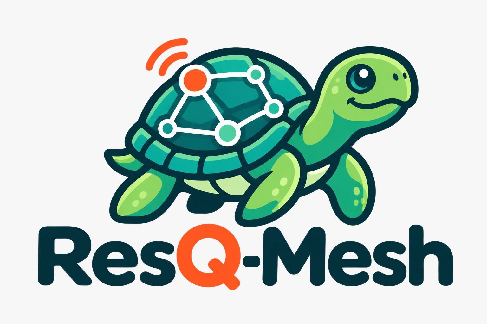
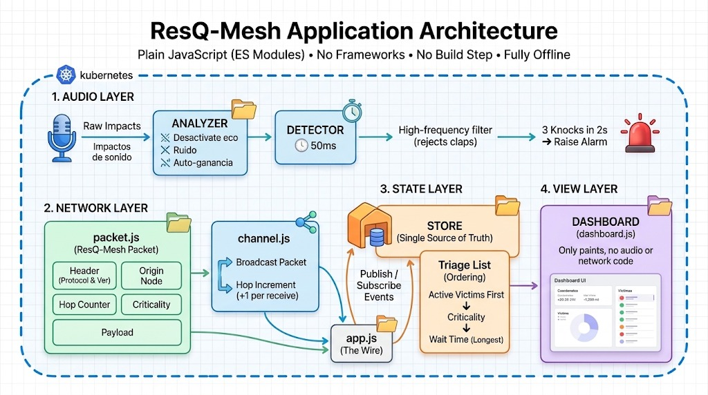

<p align="center">
  
</p>

# ResQ-Mesh

**Offline rescue and location network.** After an earthquake, with no cell towers and no internet, a phone or laptop becomes an acoustic radar and an emergency beacon: the trapped person knocks three times, the app detects the impacts through the microphone, sends an alert over a P2P mesh, and the command center sees it in a prioritized triage list.

> Team: **[TEAM NAME]** · Members: **[NAMES]**

---

## How it works

1. **Survivor.** Activates the *Debris Sensor* (or presses *MANUAL SOS*). The detector listens to the microphone; three knocks within 2 seconds trigger the alarm and a high-pitched siren.
2. **Mesh network.** The alarm becomes a ResQ-Mesh packet that is broadcast over the channel. Every node that receives it adds one hop (`hops`).
3. **Command center.** The alert appears in the triage table, sorted by urgency. Rescuers can trigger a **response siren** on the victim's device and **mark the sector as attended**.

## Run the demo

The app uses ES modules and the microphone, so it **needs a local server** (do not open it with `file://`):

```bash
python -m http.server 8000
```

Open two tabs in the **same browser**:

| Role | URL |
|---|---|
| Command center | `http://localhost:8000/index.html?rol=mando` |
| Survivor | `http://localhost:8000/index.html?rol=victima&sector=B` |

Optional parameters: `sector=A` (victim's sector), `id=VICTIMA-01` (node identifier), `seed=0` (command center starts without sample victims).

Suggested walkthrough: the command center shows 3 sample victims → in the survivor tab, activate the sensor and knock 3 times (or press SOS) → a CRITICAL row appears in the command center and `[RX HOP 1]` in the terminal → press *Activate response siren* → press *Mark sector attended*.

It also works with a single tab: the app receives a local copy of its own transmission (see [Limitations](#limitations)).

## Architecture



```
index.html · css/styles.css
js/
├── app.js                    Orchestrator: role from URL, alarm → packet → network flow
├── audio/
│   ├── analyzer.js           Microphone + AnalyserNode (no AGC, noise suppression or echo cancellation)
│   ├── detector.js           3-impact detection with hysteresis and anti-clap filter
│   └── alert-sound.js        Rescue siren and incoming-packet beep
├── network/
│   ├── packet.js             Frame format, creation and validation
│   └── channel.js            Transport (BroadcastChannel); adds 1 hop on receive
├── state/
│   └── store.js              Global state, events (subscribe) and triage ordering
├── views/
│   ├── dashboardView.js      Rendering only: beacon, network and command (no audio/network logic)
│   └── dashboardBinding.js   Connects store events to the view and buttons to app.js
└── utils/
    └── helpers.js            AUDIO_CONFIG and CHANNEL_NAME
```

Data flow:

```
microphone → analyzer → detector → store.activarAlarma → app.js builds the packet
→ channel (broadcast) → other node: channel (+1 hop) → store.registrarPaquete
→ triage → dashboardView
```

No module calls another directly: they communicate through the store (publish/subscribe) and the packet format.

### Packet format

```js
{
  header:      { protocol: 'RESQ-MESH', version: 1, packetId, type: 'ALERT' | 'STATUS' | 'ACK' },
  origin:      { nodeId, role: 'VICTIM' | 'BASE' },
  timestamp,   // ISO 8601
  hops,        // integer ≥ 0
  coordinates: { latitude, longitude, accuracy, simulated },
  criticality: 'LOW' | 'MEDIUM' | 'HIGH' | 'CRITICAL',
  event,       // 'IMPACT_DETECTED' | 'MANUAL_SOS' | 'RESPONSE_SIREN' | 'SECTOR_ATENDIDO'
  payload      // cause, sector, battery, impacts, level, peak, dominantFreq, target…
}
```

Coordinates are simulated (Quito by default) until real GPS is integrated.

## Sensor calibration

Everything is centralized in `js/utils/helpers.js` (`AUDIO_CONFIG`):

| Parameter | Value | Effect |
|---|---|---|
| `IMPACT_THRESHOLD_HIGH` | 0.40 | Level required to count a knock |
| `IMPACT_THRESHOLD_LOW` | 0.28 | Re-arm level |
| `IMPACT_TARGET` / `IMPACT_WINDOW_MS` | 3 / 2000 ms | Knocks needed within the window |
| `DEBOUNCE_MS` | 120 | Minimum gap between knocks |
| `GAIN_BOOST` | 3.2 | Gain calibrated for knuckles on wood |
| `MAX_HIGH_FREQ_RATIO` | 1.60 | Rejects sharp sounds (claps) on the first knock |

After the first knock the effective threshold drops by about 18% to compensate for the operating system's microphone compression. When you activate the sensor, accept the browser's microphone permission.

## Technologies

- JavaScript (ES modules), no frameworks, no build step
- Web Audio API (`getUserMedia`, `AnalyserNode`, oscillators for the sirens)
- BroadcastChannel API (simulated mesh transport)
- HTML5 and custom CSS, no CDN: works offline
- Manual and automated testing with Playwright during development (the scripts are not part of the repository)

## Limitations

- **The mesh is simulated.** `BroadcastChannel` only connects tabs of the same browser and origin; it is not real P2P between devices. Only `channel.js` knows about the transport, so it can be replaced (WebRTC, Bluetooth) without touching the rest.
- **Single tab.** `BroadcastChannel` does not deliver a message to its sender, so `app.js` simulates the mesh echo with a local copy (+1 hop, 400 ms).
- **Simulated coordinates** and no map.
- **Browser:** requires `BroadcastChannel`, Web Audio and microphone permission on `localhost` or HTTPS.
- Pending: full contrast review (WCAG), complete keyboard use and testing on a real phone.

## Next steps

- Real device-to-device transport and multi-hop relaying
- Real GPS and a victim map
- Local persistence of alerts and retries
- Automated tests inside the repository